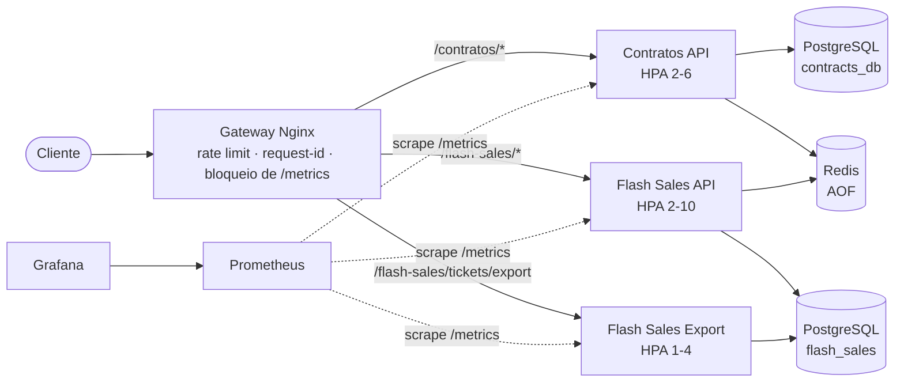
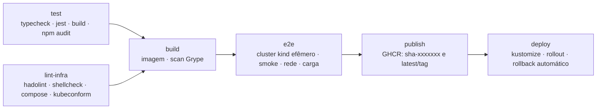

# Infraestrutura DevOps — APIs de Contratos e Flash Sales

Infraestrutura completa de implantação, automação e operação para as duas APIs fornecidas
(**Contratos** e **Flash Sales**), ambas em Node.js/TypeScript com PostgreSQL e Redis.

O mesmo conjunto de imagens e configurações roda em dois ambientes:

| Ambiente | Ferramenta | Uso |
|---|---|---|
| Desenvolvimento | Docker Compose | Subir tudo com um comando, iterar rápido |
| Kubernetes local | kind + Kustomize | Ambiente próximo de produção: autoscaling, NetworkPolicies, Pod Security |
| Produção (opcional) | Kustomize + GitHub Actions | Deploy contínuo em qualquer cluster Kubernetes |

A justificativa das decisões de arquitetura está em [ARQUITETURA.md](ARQUITETURA.md).

---

## Arquitetura



- **Gateway (Nginx)**: ponto único de entrada. Roteia por prefixo, aplica rate limiting, injeta `X-Request-ID`,
  gera logs JSON e impede o acesso externo ao `/metrics`.
- **Flash Sales Export**: a mesma imagem da Flash Sales, em um deployment separado, recebe apenas a rota de
  exportação (que consome muita CPU e memória e bloqueia o event loop). Assim o checkout não é afetado (padrão *bulkhead*).
- **PostgreSQL**: uma instância, um banco e um usuário por serviço (cada API só acessa o próprio banco).
- **Redis**: estoque de ingressos e cache, com persistência AOF e senha.
- **Prometheus + Grafana**: coleta das métricas que as APIs já expõem, 5 regras de alerta e um dashboard provisionado.

## Estrutura do repositório

```
.
├── services/
│   ├── contratos/              # API de Contratos + Dockerfile
│   └── flash-sales/            # API de Flash Sales + Dockerfile
├── config/                     # Configuração compartilhada entre Compose e Kubernetes
│   ├── gateway/                # Template do Nginx
│   ├── postgres/               # Script de criação dos bancos e usuários
│   ├── prometheus/             # Scrape (Compose e K8s) e regras de alerta
│   ├── grafana/                # Datasource, provider e dashboard
│   └── kustomization.yaml      # Gera os ConfigMaps a partir desses arquivos
├── k8s/
│   ├── kind-cluster.yaml       # Cluster local: 1 control-plane + 2 workers
│   ├── kind-cluster-single-node.yaml  # Alternativa para máquinas com pouca memória
│   ├── addons/calico/          # CNI com suporte a NetworkPolicy
│   ├── addons/metrics-server/  # Fonte de métricas do HPA
│   ├── base/                   # Manifestos comuns a todos os ambientes
│   └── overlays/
│       ├── local/              # kind: NodePorts, imagens :local, secret gerado, seed do Redis
│       └── production/         # Imagens do GHCR, LoadBalancer, mais storage e réplicas
├── scripts/                    # k8s-up, k8s-down, k8s-debug, load-test
├── tests/
│   ├── smoke/smoke-test.sh     # Testes funcionais pelo gateway (usado também no CI)
│   ├── network/network-policy-test.sh  # Verifica o isolamento de rede no cluster
│   └── load/load-test.js       # Teste de carga com k6
├── .github/
│   ├── workflows/ci-cd.yml     # Pipeline de CI/CD
│   └── dependabot.yml          # Atualização automática de dependências
├── docker-compose.yml
└── .env.example
```

## Pré-requisitos

| Ferramenta | Versão testada | Necessária para |
|---|---|---|
| Docker (Desktop ou Engine) com Compose v2 | 29.x | Todos os cenários |
| Bash | Git Bash no Windows, ou nativo no Linux/macOS | Scripts |
| curl | qualquer | Smoke test |
| [kind](https://kind.sigs.k8s.io/docs/user/quick-start/#installation) | 0.27 | Kubernetes local |
| [kubectl](https://kubernetes.io/docs/tasks/tools/) | 1.31+ | Kubernetes local |
| openssl | qualquer | Geração de senhas no Kubernetes local |
| Node.js | 24 | Somente para rodar testes fora do Docker |

> No Windows, rode os comandos no **Git Bash**. Os scripts usam apenas Bash, curl, Docker, kind e kubectl.
>
> **Memória para o Kubernetes local**: com 6 GiB ou mais disponíveis para o Docker, o script cria um cluster de
> 3 nós; com menos, cria automaticamente um cluster de nó único (mesmos manifestos, mesmo comportamento). No
> Docker Desktop com WSL2 a memória é definida no arquivo `%UserProfile%\.wslconfig` (`[wsl2]` → `memory=8GB`);
> com Hyper-V, em *Settings → Resources*.

## Ajustes feitos nas APIs

As APIs foram mantidas como fornecidas, exceto pelo mínimo necessário para que possam ser construídas e operadas:

- **Build de produção**: scripts `build`, `start`, `typecheck` e `test` no `package.json` e `tsconfig.build.json`
  (antes só havia execução via `ts-node-dev`).
- **Flash Sales não compilava**: o `tsconfig.json` usava a opção `noUncheckedSideEffectImports`, que não existe no
  TypeScript 5.5 instalado, e não habilitava `experimentalDecorators`/`emitDecoratorMetadata`, exigidos pelo TypeORM.
  A entidade `Order` também não passava no modo `strict`. Os três problemas foram corrigidos.
- **Health checks**: `GET /health` (liveness, o processo responde) e `GET /ready` (readiness, verifica PostgreSQL e Redis).
- **Encerramento gracioso**: no `SIGTERM` o servidor para de aceitar conexões, termina as requisições em andamento e
  fecha banco e Redis. Se o banco não conectar na inicialização, o processo encerra com erro (antes ficava vivo sem servir).
- **Senha do Redis**: lida de `REDIS_PASSWORD` (opcional).
- **Testes**: testes unitários do `HealthController` nas duas APIs.

---

## 1. Ambiente com Docker Compose

### Subir

```bash
cp .env.example .env
```

Edite as senhas no `.env` (opcional em ambiente local) e suba tudo:

```bash
docker compose up -d --build
```

Na primeira execução as imagens são construídas e o PostgreSQL cria os bancos `contracts_db` e `flash_sales`.
O serviço `redis-seed` cadastra dois eventos: `show-2026`, com 1000 ingressos, usado nos testes manuais e no
smoke test, e `show-carga`, com 100 mil ingressos, usado pelo teste de carga (assim um teste não esgota o estoque do outro).

```bash
docker compose ps
```

Todos os serviços devem aparecer como `healthy` (o `redis-seed` termina com `Exited (0)`).

### Endereços

| Serviço | URL |
|---|---|
| Gateway (APIs) | http://localhost:8080 |
| Prometheus | http://localhost:9090 |
| Grafana | http://localhost:3000 (usuário `admin`, senha `GRAFANA_ADMIN_PASSWORD` do `.env`) |

PostgreSQL, Redis e as APIs não ficam expostos no host: estão em uma rede interna (`backend`) e só são acessíveis pelo gateway.

### Testar

```bash
bash tests/smoke/smoke-test.sh http://localhost:8080
```

O smoke test executa 15 verificações (criação de contrato, validações, checkout, estoque esgotado, exportação,
bloqueio do `/metrics` etc.) e termina com `Todas as verificações passaram.`

Teste de carga (veja os detalhes na seção 2):

```bash
bash scripts/load-test.sh compose
```

### Escalar uma API

```bash
docker compose up -d --scale contratos=3
```

O gateway resolve o DNS dinamicamente e distribui as requisições entre as réplicas (veja o campo `upstream_addr`
em `docker compose logs gateway`). O Prometheus também descobre as novas réplicas automaticamente via DNS.

### Encerrar

```bash
docker compose down
```

Para apagar também os volumes (dados do banco, Redis e métricas):

```bash
docker compose down -v
```

---

## 2. Ambiente Kubernetes local (kind)

### Provisionar

```bash
bash scripts/k8s-up.sh
```

O script é idempotente (pode ser executado de novo para aplicar mudanças) e faz, em ordem:

1. Cria o cluster `atividade-devops` no kind: 1 control-plane e 2 workers (`k8s/kind-cluster.yaml`) ou, se o Docker
   tiver menos de 6 GiB de memória, um único nó (`k8s/kind-cluster-single-node.yaml`).
2. Instala o Calico como CNI (`k8s/addons/calico`) e o metrics-server (`k8s/addons/metrics-server`), necessário para o HPA.
   O CNI padrão do kind não aplica NetworkPolicies no Docker Desktop/WSL2 (o kernel não tem o módulo NFQUEUE que
   ele usa); com o Calico as políticas de rede funcionam igual em Windows, Linux, macOS e no CI.
3. Constrói as imagens `contratos-api:local` e `flash-sales-api:local` e as carrega nos nós do cluster.
4. Gera `k8s/overlays/local/secrets.env` com senhas aleatórias (o arquivo não é versionado).
5. Aplica o overlay `k8s/overlays/local` com `kubectl apply -k`.
6. Aguarda PostgreSQL, Redis, APIs, gateway, Prometheus, Grafana e o Job de seed ficarem prontos.

Variáveis opcionais: `SKIP_BUILD=1` reaproveita imagens já construídas e `KIND_CONFIG=<arquivo>` força uma
configuração de cluster específica.

### Endereços

As portas do Kubernetes são diferentes das do Compose, para que os dois ambientes possam rodar ao mesmo tempo.

| Serviço | URL |
|---|---|
| Gateway (APIs) | http://localhost:8081 |
| Prometheus | http://localhost:9091 |
| Grafana | http://localhost:3001 (usuário `admin`, senha `GRAFANA_ADMIN_PASSWORD` em `k8s/overlays/local/secrets.env`) |

### Testar

```bash
bash tests/smoke/smoke-test.sh http://localhost:8081
```

Verificar o isolamento de rede: o teste cria um pod sem permissões no namespace e confirma que ele alcança o
gateway, mas **não** alcança as APIs, o PostgreSQL nem o Redis diretamente.

```bash
bash tests/network/network-policy-test.sh
```

Inspecionar o ambiente:

```bash
kubectl -n apis get pods,hpa,pdb,networkpolicy
```

### Ver o autoscaling funcionando

Em um terminal, acompanhe os HPAs:

```bash
kubectl -n apis get hpa -w
```

Em outro, gere carga (o k6 roda em container, não precisa instalar nada):

```bash
DURATION=3m bash scripts/load-test.sh k8s
```

O teste sobe a carga em rampa por 30 s, mantém o pico por `DURATION` e verifica limites de qualidade (menos de 2%
de erros e p95 abaixo de 500 ms). O container do k6 é conectado à rede Docker do ambiente (`kind` ou a rede do
Compose) e acessa o gateway diretamente: no Windows, o encaminhamento de portas do Docker Desktop vira gargalo
com centenas de conexões e mediria o Docker, não as APIs. A intensidade é configurável por variáveis de ambiente:

| Variável | Padrão | Significado |
|---|---|---|
| `DURATION` | `2m` | Tempo no pico |
| `CONTRATOS_RPS` | `20` | Requisições por segundo em `POST /contratos/contracts` |
| `CHECKOUT_RPS` | `40` | Requisições por segundo em `POST /flash-sales/checkout` |
| `EXPORT_VUS` | `1` | Exportações executando em paralelo, continuamente |
| `EXPORT_RECORDS` | `200000` | Registros por exportação |
| `EVENT_ID` | `show-carga` | Evento usado no checkout |

Com a carga, os HPAs aumentam as réplicas em cerca de 30 a 60 segundos e as reduzem ao mínimo depois da janela
de estabilização de 5 minutos. No overlay local os máximos são menores (4 réplicas para as APIs e 3 para gateway e
exportação) para caber em uma máquina de desenvolvimento; o overlay de produção usa os valores da base (até 10 para o
checkout, 20 em produção). O dashboard **APIs - Visão Geral** no Grafana mostra as novas instâncias, a vazão, a
latência e o lag do event loop.

### Testar a resiliência

Apague um pod e veja o Kubernetes recriá-lo enquanto o gateway continua respondendo pela outra réplica:

```bash
kubectl -n apis get pod -l app.kubernetes.io/name=contratos -o name | head -1 | xargs kubectl -n apis delete
```

```bash
bash tests/smoke/smoke-test.sh http://localhost:8081
```

### Diagnóstico

```bash
bash scripts/k8s-debug.sh
```

### Remover o cluster

```bash
bash scripts/k8s-down.sh
```

---

## 3. Testando as APIs manualmente

Os exemplos usam a porta do Compose (`8080`); no Kubernetes troque por `8081`.

**Criar contrato** (`title` e `userId` obrigatórios):

```bash
curl -i -X POST http://localhost:8080/contratos/contracts -H "Content-Type: application/json" -d '{"title":"Contrato de prestação de serviço","userId":"user-1","description":"Exemplo","value":2500}'
```

Resposta esperada: `201 Created` com o contrato criado (o último contrato de cada usuário também fica em cache no Redis por 1 hora).

**Comprar ingressos** (`eventId`, `userId` e `quantity` obrigatórios):

```bash
curl -i -X POST http://localhost:8080/flash-sales/checkout -H "Content-Type: application/json" -d '{"eventId":"show-2026","userId":"user-1","quantity":2}'
```

Respostas: `201` (compra confirmada), `409` (estoque insuficiente ou evento sem estoque cadastrado), `400` (campos faltando).

**Exportar relatório** (operação pesada, roteada para o deployment `flash-sales-export`):

```bash
curl -i -X POST http://localhost:8080/flash-sales/tickets/export -H "Content-Type: application/json" -d '{"records":100000}'
```

**Health checks**: `GET /contratos/health`, `GET /contratos/ready`, `GET /flash-sales/health`, `GET /flash-sales/ready`
e `GET /healthz` (gateway).

**Cadastrar estoque para outro evento.** O estoque fica no Redis, na chave `event:<eventId>:tickets`. No Compose:

```bash
docker compose exec redis redis-cli SET event:festival-2027:tickets 500
```

No Kubernetes:

```bash
kubectl -n apis exec redis-0 -- redis-cli SET event:festival-2027:tickets 500
```

### Limites aplicados pelo gateway

| Rota | Limite por IP | Resposta ao exceder |
|---|---|---|
| `/flash-sales/checkout` | 100 req/s (rajada de 200) | `429` |
| `/contratos/*` e demais rotas de `/flash-sales/*` | 50 req/s (rajada de 100) | `429` |
| `/flash-sales/tickets/export` | 4 exportações simultâneas (total) | `429` |
| `*/metrics` | bloqueado | `404` |

---

## 4. Observabilidade

- **Métricas**: as APIs expõem `/metrics` (prom-client). O Prometheus descobre os alvos sozinho: via DNS no
  Compose e via API do Kubernetes (pods com a annotation `prometheus.io/scrape: "true"`) no cluster.
- **Dashboard**: o Grafana já sobe com o datasource e o dashboard **APIs - Visão Geral** (instâncias ativas,
  taxa de erro, latência p50/p95 por rota, requisições por status, CPU, memória e lag do event loop).
- **Alertas** (`config/prometheus/alerts.yml`), visíveis em *Prometheus → Alerts*:

  | Alerta | Condição |
  |---|---|
  | `ApiInstanceDown` | Instância sem responder ao scrape por 1 min |
  | `ApiHighErrorRate` | Mais de 5% de respostas 5xx por 5 min |
  | `ApiHighLatencyP95` | p95 acima de 1 s por 5 min |
  | `ApiEventLoopBlocked` | Lag p99 do event loop acima de 1 s por 1 min |
  | `ApiHighMemory` | Memória residente acima de 450 MiB por 5 min |

- **Logs**: o gateway gera logs JSON com `request_id`, status, tempo de resposta e réplica de destino. O mesmo
  `X-Request-ID` é enviado para as APIs e devolvido ao cliente, permitindo correlacionar uma requisição de ponta a ponta.

---

## 5. Pipeline de CI/CD (GitHub Actions)

Arquivo: [.github/workflows/ci-cd.yml](.github/workflows/ci-cd.yml). Roda em pull requests, pushes na `main` e tags `v*`.



| Job | O que faz | Quando |
|---|---|---|
| `test` | Instala dependências, verifica tipos, roda os testes com cobertura, compila e audita dependências de produção (matriz com as duas APIs) | Sempre |
| `lint-infra` | Lint dos Dockerfiles (hadolint), dos scripts (ShellCheck), valida o `docker-compose.yml` e os manifestos dos dois overlays contra o schema do Kubernetes (kubeconform) | Sempre |
| `build` | Constrói as imagens com cache, falha se houver vulnerabilidade **crítica com correção disponível** (Grype) e guarda a imagem como artefato | Sempre |
| `e2e` | Cria um cluster kind dentro do runner, carrega **as mesmas imagens** do job anterior, aplica o overlay local com `scripts/k8s-up.sh` e roda o smoke test, o teste de isolamento de rede e um teste de carga curto com limites de erro e latência. Em caso de falha, imprime o diagnóstico | Sempre |
| `publish` | Publica no GitHub Container Registry exatamente a imagem testada, com as tags `sha-<commit>` e `latest` (ou a versão da tag) | Push na `main` ou tag `v*` |
| `deploy` | Fixa as imagens do commit no overlay de produção, aplica, aguarda o rollout e faz `rollout undo` se algo falhar | Push na `main` com deploy habilitado |

### Habilitar o deploy contínuo

O deploy só roda se o repositório estiver configurado (sem isso, a pipeline para no `publish`):

1. Crie o environment `production` em *Settings → Environments* (opcionalmente com aprovação manual obrigatória).
2. Adicione o secret `KUBECONFIG_B64` com o kubeconfig do cluster em base64: `base64 -w0 ~/.kube/config`.
3. Crie a variável de repositório `DEPLOY_ENABLED` com o valor `true`.
4. No cluster de produção, crie o namespace e o secret com as credenciais (elas nunca ficam no Git):

```bash
kubectl create namespace apis
```

```bash
kubectl -n apis create secret generic apis-secrets --from-literal=POSTGRES_PASSWORD=... --from-literal=CONTRATOS_DB_PASSWORD=... --from-literal=FLASH_SALES_DB_PASSWORD=... --from-literal=REDIS_PASSWORD=... --from-literal=GRAFANA_ADMIN_PASSWORD=...
```

5. Se as imagens do GHCR forem privadas, configure um `imagePullSecret` ou torne os pacotes públicos.

### Rodar as mesmas verificações localmente

```bash
cd services/contratos && npm ci && npm run typecheck && npm test && npm run build
```

```bash
kubectl kustomize k8s/overlays/production | docker run --rm -i ghcr.io/yannh/kubeconform:v0.6.7 -strict -summary -
```

---

## Solução de problemas

| Sintoma | Causa provável | Solução |
|---|---|---|
| `port is already allocated` ao subir | Porta 8080/9090/3000 em uso | Altere `GATEWAY_PORT`, `PROMETHEUS_PORT` ou `GRAFANA_PORT` no `.env` |
| Checkout sempre retorna `409` | Evento sem estoque no Redis ou estoque esgotado | Cadastre o estoque (seção 3) |
| Pod de API reinicia uma vez na primeira subida | Duas réplicas criaram o schema ao mesmo tempo (`synchronize` do TypeORM) | Nada a fazer: o Kubernetes reinicia o pod e ele sobe normalmente |
| HPA mostra `<unknown>` | metrics-server ainda coletando, ou o nó está sem recursos | Aguarde cerca de 1 minuto; se persistir, veja `kubectl top nodes` e a memória do Docker |
| Cluster lento, `etcdserver: request timed out` | Pouca memória para o Docker (a VM está usando swap) | Aumente a memória do Docker ou use `KIND_CONFIG=k8s/kind-cluster-single-node.yaml` |
| Muitos timeouts ao gerar carga em `localhost` no Windows | Limite do encaminhamento de portas do Docker Desktop | Use `scripts/load-test.sh`, que roda o k6 dentro da rede Docker |
| Senha do Postgres alterada no `.env` não tem efeito | O script de inicialização só roda com o volume vazio | `docker compose down -v` e suba novamente |
